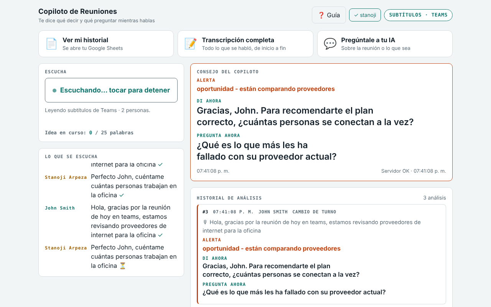
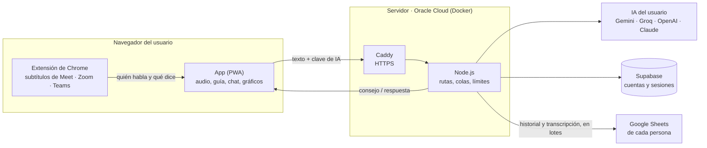

# Copiloto de Reuniones

Asistente de IA en tiempo real para reuniones de **Google Meet, Zoom y Microsoft Teams** (en el navegador). Mientras hablas, escucha la conversación y te sugiere **qué decir** y **qué preguntar**; al final, guarda el historial y la transcripción completa en el **Google Sheets de cada persona**.

Pensado para ventas, entrevistas y reuniones con clientes. Cada usuario usa **su propia clave de IA** (Gemini, Groq, OpenAI o Claude), así el servidor no paga por el uso de IA.



## Qué hace

- **Consejo en vivo:** cada ~25 palabras de una persona (o en cada pausa) muestra una alerta, una frase para decir ahora y una pregunta para hacer ahora.
- **Sabe quién habla:** una extensión de Chrome lee los subtítulos de Meet, Zoom y Teams con el nombre de cada persona. Sin extensión, usa el micrófono o el audio de la pestaña.
- **Traducción:** si alguien habla en otro idioma, la transcripción incluye la traducción.
- **Pregúntale a tu IA:** un chat que ya conoce la reunión, puede **buscar en internet** y responder con **tablas y gráficos**.
- **Transcripción completa** en pantalla, para copiar, descargar o abrir en Sheets.
- **Historial en el Google Sheets propio** de cada persona (pestañas «Historial» y «Transcripción»), con el permiso mínimo de Drive (`drive.file`).
- **Guía de inicio** en 3 pasos para personas sin conocimientos técnicos.

## Arquitectura



| Pieza | Tecnología | Qué hace |
| --- | --- | --- |
| App (PWA) | HTML + JavaScript sin dependencias | Interfaz, audio, guía, chat con la IA, gráficos SVG |
| Extensión | Chrome Manifest V3 | Lee los subtítulos de Meet, Zoom y Teams y se los pasa a la app |
| Servidor | Node.js 22 + `pg` (un solo paquete) | Sirve la app, llama a la IA del usuario, escribe en Google Sheets |
| Base de datos | Supabase (PostgreSQL) | Cuentas conectadas, sesiones en curso, cupo diario |
| Infraestructura | Oracle Cloud Always Free + Docker Compose + Caddy (HTTPS) | Todo corre gratis en una VM ARM |

Detalles de diseño:

- **Sin claves de IA en el servidor:** la clave viaja desde el navegador del usuario en cada petición y no se guarda.
- **Refresh tokens de Google cifrados** en la base de datos (`pgp_sym_encrypt`); los navegadores se identifican con un token del que solo se guarda el hash.
- **Preparado para ~100 personas a la vez:** límite de peticiones por persona, escrituras a Google Sheets en lotes con reintentos ante el error 429, caché de sesiones en memoria y vaciado de colas al apagar.
- **Búsqueda web por proveedor:** Gemini (Google Search), OpenAI (`web_search`), Claude (`web_search`) y Groq (`browser_search`); si el plan gratis de Gemini no permite buscar, usa la clave gratis de Groq del usuario.

## Estructura

```
servidor/           Servidor Node.js
  src/              server.js (rutas), copiloto.js (lógica), externos.js (IA y Google), db.js, prompts.js, fechas.js
  public/           La app (index.html, service worker, política de privacidad, página para instalar la extensión)
  Dockerfile        Imagen node:22-alpine
  instalar.sh       Instala el servicio junto a Docker Compose y Caddy
  actualizar_*.sh   Actualizan el servidor o solo la app, con copia de seguridad
extension/          Extensión de Chrome (Manifest V3)
sql/esquema.sql     Tablas de Supabase y limpieza diaria (pg_cron)
scripts/            Respaldo diario de Supabase y cómo restaurarlo
pruebas/            Pruebas automáticas (servidor, navegador y extensión)
docs/               Diagramas y capturas
```

## Puesta en marcha

1. **Supabase:** crea un proyecto y ejecuta `sql/esquema.sql` en el editor SQL. Descarga el certificado CA de la base de datos.
2. **Google Cloud:** crea un cliente OAuth (aplicación web) con el permiso `https://www.googleapis.com/auth/drive.file` y agrega tu dominio como origen autorizado.
3. **Configura** `servidor/env.ejemplo` → `.env` (lo hace `instalar.sh`) y pon tu dominio y tu `GOOGLE_CLIENT_ID` en `servidor/public/index.html` y en `extension/manifest.json`.
4. **Servidor:** en una VM con Docker y Caddy, copia la carpeta `servidor` a `/opt/copiloto` y ejecuta `sudo sh instalar.sh`. Los scripts asumen que el `docker-compose.yml` con Caddy está en `/opt/n8n`.
5. **Respaldo (recomendado):** instala `scripts/respaldo_supabase.sh` en el cron de root.

Variables de entorno (`servidor/env.ejemplo`):

| Variable | Para qué |
| --- | --- |
| `GOOGLE_CLIENT_ID`, `GOOGLE_CLIENT_SECRET` | Cliente OAuth de Google |
| `CLAVE_CIFRADO` | Cifra los refresh tokens (`openssl rand -hex 32`) |
| `DB_*` | Conexión a Supabase (session pooler) y certificado CA |
| `MAX_CUENTAS`, `LIMITE_DIARIO`, `RATE_LIMIT_PER_MIN` | Cupos de uso |
| `ALLOWED_ORIGINS` | Otros dominios que pueden usar el servidor |

## Pruebas

Requieren Linux, Node.js 22, PostgreSQL 16 local (lo levanta `levantar_pg.sh`), Google Chrome y Playwright. Las llamadas a la IA y a Google están simuladas.

```
cd pruebas
sh levantar_pg.sh
node prueba_integral.js     # 44 comprobaciones del servidor
node prueba_nuevas.js       # transcripción, preguntas a la IA y búsqueda web
node prueba_100.js          # límites por persona y escrituras en lote con muchos usuarios
node prueba_navegador.js    # la app de punta a punta en Chrome
DOMINIO_REAL=1 node prueba_extension.js   # la extensión en Meet, Zoom y Teams simulados
```

## Historia del proyecto

1. Prototipo con flujos de **n8n** y la app en Netlify.
2. Versión multiusuario: inicio de sesión con Google, historial en el Sheets de cada persona y Supabase.
3. n8n autoalojado en **Oracle Cloud Always Free** con Docker, Caddy y monitoreo con UptimeRobot.
4. Migración del motor de n8n a **Node.js** (con una prueba de equivalencia de 831 casos contra los flujos originales) y la app servida desde el mismo servidor.
5. Preparado para 100 personas: límites por persona, escrituras en lote y respaldo diario.

## Privacidad

La política completa está en `servidor/public/privacidad.html`. En resumen: el historial queda en el Google Sheets de cada persona, las sesiones se borran a las 24 horas y la extensión solo lee los subtítulos de las páginas de reuniones.

## Autor

Desarrollado por Stanoji Peña, ingeniero de telecomunicaciones en Lima, Perú ([github.com/stanojiarpeza](https://github.com/stanojiarpeza)).
